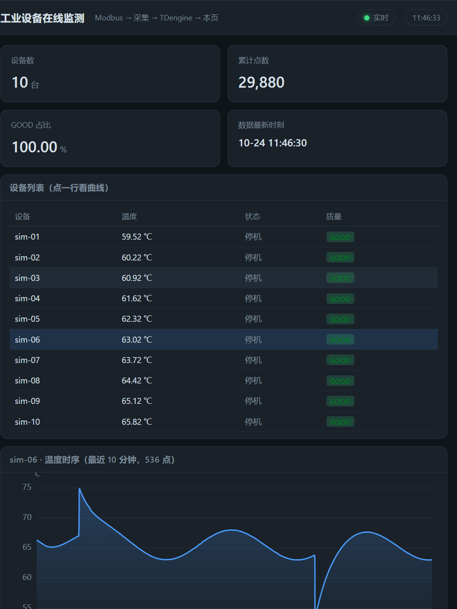

# 工业设备数据采集与在线监测

> **一句话**：把工业现场的数据链路完整走一遍 —— **南向 Modbus（TCP/RTU）→ 统一数据模型（含质量码）→ 时序库 → Web 监测页**。
> 全部可复现，一条命令起仿真设备，不需要真实硬件。

> ⚠️ **个人学习 / 演示项目，不是生产系统。** 目的是验证**协议链路、数据模型与平台形态**；联锁、硬实时、停机变更审批这些真实产线的部分没做，也不假装做过（见文末「边界」）。

---

## 为什么不是"再做一个看板"

工业数据和互联网数据的差别不在"量大"，而在这三件事：

| 差别 | 后果 |
|---|---|
| 数据在**二进制寄存器**里，不在 JSON 里 | 一个 Float32 要拼两个 16 位寄存器，**字节序有 4 种**（ABCD/CDAB/BADC/DCBA），猜错就是天文数字 |
| 数据**可能不可信** | 设备掉线时不能补 0（下游会把"0℃"当真温度），必须显式标"这条是旧的" |
| **点位约定写在厂家手册里** | 寄存器地址、类型、字序、量程都是"某台设备的私有约定"，**不该硬编码进代码** |

这个项目的重点就是把这些做成**工程约束**，而不是"能跑就行"。见 [九个坑](#九个坑每条都是我以为-x-其实-y)。

### 页面长什么样



真实运行截图（10 台仿真设备，1 Hz 采集写进 TDengine，页面每 3 秒刷新）：
左侧是各设备当前值与**质量码**，下方是选中设备的**最近 10 分钟温度曲线**。
曲线里能同时看到一阶低通造成的**惯性回落**、缓慢**漂移**、以及 0.5% 概率的**单点尖峰** ——
这就是[坑 0](#坑-0--假数据一眼假--2026-10-24-补证据)说的"真信号的质感"，`random()` 画不出这些。

---

## 架构

```
┌───────────────── 设备层（南向） ─────────────────┐
│   仿真从站 × N            真传感器 × 1            │
│   Modbus TCP               Modbus RTU / RS485    │
└───────┬───────────────────────────┬──────────────┘
        │                           │
┌───────▼───────────────────────────▼──────────────┐
│  collector（Java 21，可独立 main 运行）            │
│                                                   │
│  DeviceDriver（抽象层）                            │
│    ├── TcpModbusDriver   ← 已实现                  │
│    └── RtuModbusDriver   ← 已留接口（等硬件）       │
│                                                   │
│  DeviceSampler   ← 质量码 GOOD / STALE / BAD       │
│                    量程校验（越界判 BAD）            │
│                                                   │
│  每设备一条虚拟线程 + 独立 driver + 失败退避         │
└───────────────────────┬──────────────────────────┘
                        │ 批量 REST（攒 500 点 / 500 ms）
┌───────────────────────▼──────────────────────────┐
│  TDengine 3.3（WSL2 内，免 root）                  │
│  超级表 telemetry + 每「设备×点位」一张子表         │
└───────────────────────┬──────────────────────────┘
                        │ SQL（只读）
┌───────────────────────▼──────────────────────────┐
│  platform（Spring Boot + ECharts）                 │
│  /api/overview · /api/latest · /api/series        │
└───────────────────────────────────────────────────┘
```

**为什么采集端和平台分开**：采集挂了历史还在，平台照样能看过去 30 分钟；平台被刷爆不影响 10ms 级的采集。

**数据新鲜度**：`/api/latest` 与 `/api/overview` 会算「最新点距今多少秒」，超过 15 秒标 **过期** —— 因为库里存的 quality 是"写进去那一刻"的，采集端停了它**仍然是 GOOD**，页面若不判断就会"安静地骗人"。详见 `docs/新鲜度检查.md`。

**北向 MQTT**：采集端同时把数据发布到 `iiot/{device}/{point}`（QoS 1 + retain），
给第三方系统订阅 —— 页面走 HTTP，MES/SCADA/大屏走 MQTT，两条路互不影响。

---

## 实测数据（都是跑出来的，不是估算）

### 100 台设备 × 4 点位 × 1 Hz × 60 秒

| 指标 | 值 |
|---|---|
| 期望点数 | 24000 |
| 实际点数 | **24000（GOOD 24000 / STALE 0 / BAD 0）** |
| **采集完整率** | **100.00%** |
| **入库吞吐** | **388 点/秒** |
| **采集延迟** | P50 **1.27 ms** · P95 **4.14 ms** · P99 **9.95 ms** |
| **TDengine 写入** | **24000 点 / 195 批 · 失败 0 · 队列丢弃 0** |

> 每批约 123 点 ⇒ HTTP 请求被压到 **约 3 次/秒**，而不是 400 次/秒。

### 断线演练（跑到一半把从站杀了）

```
[10:31:34]  ·  6s  GOOD 480 / 期望 480  （100.00%）· STALE 0   · BAD 0
[10:31:37]  ·  9s  GOOD 640 / 期望 720  （ 88.89%）· STALE 80  · BAD 0   ← 杀从站
[10:31:40]  · 12s  GOOD 640 / 期望 880  （ 72.73%）· STALE 240 · BAD 0
[10:31:52]  · 24s  GOOD 640 / 期望 1040 （ 61.54%）· STALE 400 · BAD 0
```

**三件事同时成立**：① 断线后是 **STALE 不是 0**；② **BAD = 0**（因为断线前都读到过好值）；③ **采集器没崩**，继续跑完并正常收工。

### 字序证伪

同一帧寄存器（`0x704A` / `0x4280`）按四种字序各解一遍：

```
ABCD             2.5039e+29    （不像温度）
CDAB                  64.22    ← 落在合理区间
BADC             3.9404e+06    （不像温度）
DCBA            -6.0878e-39    （不像温度）
```

---

## 快速开始（Windows + JDK 21）

构建用 Maven Wrapper，**不需要本机装 Maven**：

```powershell
.\mvnw.cmd -DskipTests package
```

### 完整链路（含时序库 + 页面）

```powershell
# 1) 起时序库（WSL2 里以普通用户运行 taosd + taosAdapter，不需要 root/sudo）
device\tdengine\start-tdengine.cmd

# 2) 起仿真从站：100 个从站号挂在同一个端口
#    （= RS485 网关后面挂 100 台表：host/port 相同，unitId 不同）
collector\run-slave.cmd --port 1502 --devices 100

# 3) 采集并写入 TDengine
collector\run-multi-tdengine.cmd --fanout 100 --duration 60

# 4) 起监测页面 → http://localhost:8080
platform\run-platform.cmd

# 可选：北向 MQTT（起 broker + 看消息流）
device\mqtt\start-mqtt.cmd
collector\run-multi.cmd --fanout 10 --duration 60 --northbound mqtt
device\mqtt\subscribe.cmd          # 另开一个窗口看 iiot/# 的数据流
```

### 只想验证协议/性能（不装时序库）

```powershell
collector\run-slave.cmd --port 1502 --devices 10
collector\run-multi.cmd --fanout 10 --duration 30     # --store counting（默认，不落盘）
```

### 只看协议：四字序探测 + 写线圈

```powershell
collector\run-probe.cmd --port 1502
collector\run-probe.cmd --port 1502 --write-motor true   # FC05 写线圈并读回确认
```

---

## 点位表

| 点位 | 类型 | Modbus 区 / 偏移 | 惯用编号 | 功能码 | 读/写 |
|---|---|---|---|---|---|
| `temperature` | Float32（2 寄存器） | holding 0–1 | 40001–40002 | FC03 | 只读 |
| `runtime_hours` | UInt32（2 寄存器） | holding 2–3 | 40003–40004 | FC03 | 只读 |
| `motor_running` | BOOL（线圈） | coil 0 | 00001 | FC01 / **FC05 写** | 读写 |
| `alarm` | BOOL（离散输入） | input 0 | 10001 | FC02 | 只读 |

- `temperature` 故意用 **CDAB**、`runtime_hours` 用 **ABCD** —— 同一台设备混用两种字序在现实里很常见，所以**字序必须按点位配**，不能全局假设。
- 仿真从站监听 **1502**（不是 502）：<1024 端口在 Linux 要 root，Windows 上也容易被占。**1502 是本项目约定**。
- 温度不是 `random()`：一阶低通 + 3 分钟周期漂移 + 0.5% 尖峰 + 每周期 ±20 ms 采样抖动。`random()` 画出来是锯齿，一眼假。

### 点表：字序、类型、偏移、量程都在配置里

```properties
device.sim-01.host=127.0.0.1
device.sim-01.port=1502
device.sim-01.unitId=1
device.sim-01.periodMillis=1000
device.sim-01.points=temperature,runtime_hours,motor_running,alarm

device.sim-01.point.temperature.area=holding
device.sim-01.point.temperature.offset=0        # 0 基；惯用编号 40001
device.sim-01.point.temperature.type=float32
device.sim-01.point.temperature.order=CDAB      # 换一台表只改这一行
device.sim-01.point.temperature.unit=°C
device.sim-01.point.temperature.min=-40         # 量程：字序配错时的最后一道防线
device.sim-01.point.temperature.max=120
```

验证配置真的生效（实测）：从站 `--base-temp 25` 时读到 **25.06℃**；仅把 `order` 改成 `ABCD`，同一台设备立刻变成 **-1.52e19℃** —— 此时**量程校验会把它判成 BAD**，而不是让垃圾数据一路走到页面。

---

## 九个坑（每条都是"我以为 X，其实 Y"）

| # | 坑 | 结论 |
|---|---|---|
| 0 | **假数据一眼假** | `random()` 是锯齿；真设备有惯性/噪声/漂移/尖峰/采样抖动 |
| 1 | **寄存器字序** | Modbus 只规定寄存器是 16 位，**不规定 32 位怎么拆**。四种字节序都可能，国内仪表常见 **CDAB** |
| 2 | **40001 vs offset 0** | 手册上的 `40001` 是 1 基惯用编号，协议偏移是 0，**差一位就全错** |
| 3 | **断线不是 0** | 补 0 会让下游把"0℃"当真温度 → 必须带质量码（GOOD/STALE/BAD） |
| 4 | **写操作不幂等** | 超时后重发可能让电机启停两次 → 超时先读回确认，不要无脑重试 |
| 5 | **单设备拖垮采集** | 三重隔离（线程/连接/超时）+ 失败退避；实测 100 台断线不崩 |
| 6 | **时间基准** | TDengine 存 UTC、返回带 `Z`；前端不转时区整张图偏 8 小时 |
| 7 | **告警泛滥** | 单点越限就报 → 报警风暴。**已实现**去抖+回差+分级+质量码门禁，A/B 实测 **86 条 → 12 条（压掉 86%）** |
| 8 | **I/O 地址不是你想的那个** | CODESYS 里 `xAlarm AT %QX0.0` 编译/运行/监视全正常，但 Modbus 离散输入永远读到 0 —— 真实通道在 **`%QX20.0`**（前 20 字节被字区占了）。**地址合法 ≠ 地址正确，没有任何环节会报错** |
| 9 | **用整数验字序 = 白验** | `90.0` 时 `CDAB` 和 `ABCD` 都解得 90.00，分不出来。**判据是"低 16 位非零"，不是"带小数"**（`25.5` 也验不出来）。要 `90.1` / `25.6` 这种"难看"的值 |

每条都留了实测输出，详见 **[docs/pitfalls.md](docs/pitfalls.md)**。

---

## 目录

```
collector/            采集端（可独立 main 运行，不依赖 Spring）
  core/               DeviceDriver · DeviceSampler · PointDef · Quality · CollectStats · TelemetryRepository
  driver/             TcpModbusDriver（j2mod）
  proto/              WordOrder（四字序编解码）
  sim/                仿真从站的数据模型（TempSignal / SimDevice）与从站入口
  repo/               CountingTelemetryRepository（基线）· TdengineTelemetryRepository（真库）

platform/             只读平台：Spring Boot + ECharts（页面在 static/）
device/tdengine/      TDengine 起停脚本
docs/                 部署与踩坑记录（TDengine / OpenPLC / pitfalls / 双工具对比）
pous/                 OpenPLC 工程：LD（main.ld）/ ST（temp_check.st）/ FBD（temp_fbd.fbd）
codesys/              CODESYS 工程（同一段 ST 的对照实现）
project.json          OpenPLC 工程配置（tasks + instances）
```

---

## 技术栈与取舍

| 选择 | 为什么 |
|---|---|
| **Java 21 + 虚拟线程** | 100 台设备 = 100 条线程，平台线程太重 |
| **j2mod** | 主站 + 从站一体，能自己造仿真设备来验证协议 |
| **纯文本点表** | 厂家的点位约定不该写进代码 |
| **TDengine** | 工业圈常见；超级表 + 子表天然贴合「设备 × 点位」；单机轻量 |
| **REST 而非 JDBC** | 免 native 库、可跨 WSL / SSH 隧道；查询返回自带 `column_meta`，直接映射给前端 |
| **ECharts 本地副本** | 离线可跑，不依赖 CDN |
| **CODESYS 软 PLC** | 真运行时当 Modbus 从站（`%QW0`→输入寄存器、`%QX20.0`→离散输入）；**ST / LD / FBD 三种语言各写一遍同一逻辑**，在线验证三者同真同假 |
| **Spring Boot 3.2.5** | 与本人另一个项目对齐，便于复用本地依赖缓存（离线也能构建） |

---

## 边界（诚实说明）

- **不是生产系统**：单机、无认证、无高可用、无联锁
- **真传感器尚未接入**（等快递）：但已验证**两类数据源** —— 自写 Modbus 仿真从站 + **CODESYS 软 PLC 真实运行时**（采集端零代码改动）；`RtuModbusDriver` 已实现，并**已用 com0com 虚拟串口实测通过**（`COM5`/`COM6` 对 + j2mod 从站桩 → 读到 `25.60℃`、字序 ABCD），硬件到货只改点表里的 `comPort`
- **北向 MQTT 已实现**：`iiot/{device}/{point}`，QoS 1 + retain，Mosquitto 跑在 WSL；**但只做了"分发"**，没做认证/授权（demo 用 `allow_anonymous`，生产必须开）
- **告警只做了判断，没做通知**：`AlarmEngine` 已实现**持续时间去抖 + 回差 + 分级 + 质量码门禁**，并用 A/B 实测过（86 条 → 12 条，压掉 86%）；但**通知通道（短信/企微/邮件）与同源告警合并没做**
- **只有 4 个点位**：够验证链路，不够覆盖真实产线（一台设备几十上百点位）

---

## 相关文档

| 文档 | 内容 |
|---|---|
| ⭐⭐ [docs/面试问答-红宇精工-工业软件工程师.md](docs/面试问答-红宇精工-工业软件工程师.md) | **红宇精工公司功课**（兵装集团/40亿/3000人/七个基地/液力变矩器+AT油泵）+ **20 道问答**（含"真实生产"6 题：CNC 采集/MDC/军工涉密边界/品牌混杂/产线停机排查） |
| ⭐ [docs/工业通信协议与工厂系统-面试速查.md](docs/工业通信协议与工厂系统-面试速查.md) | **Profinet / EtherNet-IP / OPC UA / Modbus 的定位与实时性分层**；SCADA/MES/EAM 一句话定位；**10 个高频面试题答法** |
| ⭐ [docs/项目设计与踩坑总览.md](docs/项目设计与踩坑总览.md) | **一页看懂**：三层架构 · 8 个设计决策（含被否决的备选）· **20 个坑分类** · 实测数据 · 面试三个版本 · PLC 软件选型 |`r`n| [docs/pitfalls.md](docs/pitfalls.md) | 十个坑（坑 0~9）的实测过程与结论 |
| [docs/TDengine-部署与踩坑.md](docs/TDengine-部署与踩坑.md) | Windows 无服务端包 → WSL2 免 root 部署；IPv6/UTC/保留字 三个数据层坑 |
| [docs/新鲜度检查.md](docs/新鲜度检查.md) | ⭐ **采集端停了库里仍是 GOOD** —— 为什么过期判断必须在查询层、与质量码的区别、实测抓到 3 小时未更新 |
| [docs/MQTT-北向分发.md](docs/MQTT-北向分发.md) | 北向为什么是 MQTT 而不是 HTTP；topic/QoS/retain 的选择；4 个坑 |
| [docs/RTU设备接入指南.md](docs/RTU设备接入指南.md) | ⭐ **传感器到货后照着做 10 步**：接线（A/B/共地）、驱动、串口参数、点表、RTU 五大坑、验收清单 |
| [docs/PLC与Java的分工.md](docs/PLC与Java的分工.md) | ⭐ **这个项目最核心的一课**：PLC 管现在、Java 管过去；扫描≠记录；10ms vs 1s 丢了 99%；控制的是执行器不是传感器 |
| [docs/启动与运行.md](docs/启动与运行.md) | **五个程序 / 启动顺序 / 三种启动方式（脚本·命令行·IDEA）/ 参数速查 / 故障对照** |
| [docs/OpenPLC/三语言进度与踩坑.md](docs/OpenPLC/三语言进度与踩坑.md) | IEC 61131-3 三种语言（LD/ST/FBD）在同一工程里跑通 |
| [docs/双工具同一段ST-对比验证.md](docs/双工具同一段ST-对比验证.md) | 同一段 ST 在 OpenPLC 与 CODESYS 上分别编译运行 |
| [docs/CODESYS/环境搭建与踩坑.md](docs/CODESYS/环境搭建与踩坑.md) | 工业软件工具链安装 + 连通/会话/认证三层排障 |
| [docs/CODESYS/LD与FBD-怎么发挥作用.md](docs/CODESYS/LD与FBD-怎么发挥作用.md) | ⭐ **同一逻辑用 ST/LD/FBD 三种语言各写一遍，同时跑在一台 PLC 里**；LD 的能量流 / FBD 的信号流；**变量名不同但地址相同 = 共享内存** |
| [docs/CODESYS/Modbus从站接入与实测.md](docs/CODESYS/Modbus从站接入与实测.md) | ⭐ **CODESYS 当 Modbus 从站，采集端零代码改动读它**：八个坑（I/O 地址是设备分配的 / 字序歧义 / 主从翻译陷阱…）+ 现场排查顺序 |
